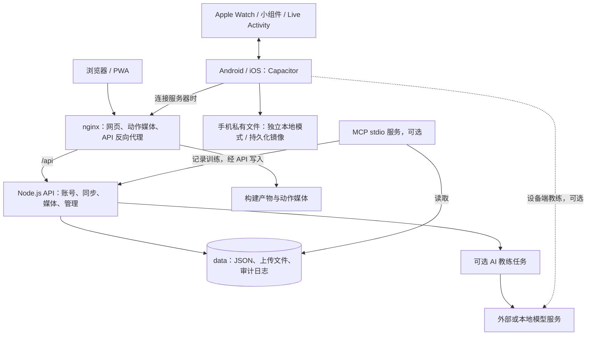
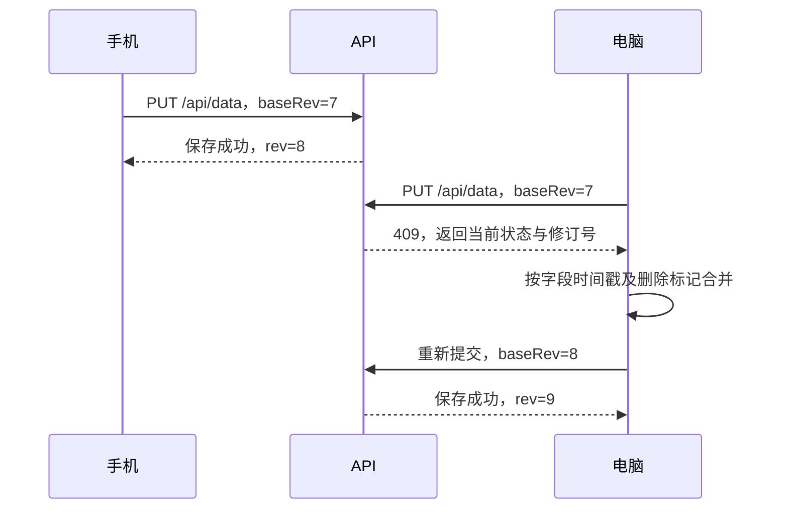

# openGym 系统结构与功能说明

本文依据当前代码（提交 `b6cfe2b`）及现有架构文档整理，面向产品理解、开发交接和部署维护。描述的是代码具备的能力；可选功能是否启用取决于部署配置。本次为结构与功能梳理，不是完整安全审计。

后续技术栈更新：项目已加入 TypeScript 严格检查基础、JS/TS 共存配置及独立 CI，业务实现已全量迁移至 TS/TSX，遗留动态类型另有清单。具体更新版本、检查命令和重构顺序见[技术栈与 TypeScript 迁移说明](TYPESCRIPT_MIGRATION.zh-CN.md)；下文测试数据为首次环境设置时的基线。

## 1. 系统定位

openGym 是可自行部署、支持离线使用的健身训练与身体数据管理系统。核心业务包括训练计划、训练过程记录、渐进超负荷、历史统计、体重与围度管理，以及多设备同步。

同一套 React 应用用于浏览器、PWA 和 Capacitor 移动应用。手机支持独立本地模式，也可以连接自建服务器。常规服务端由 nginx、Node.js API 和本地数据目录组成，无需独立数据库、Redis 或消息队列。

## 2. 总体架构



前端承担训练业务计算，后端承担共享数据和访问控制。服务端同步的是每个用户的状态文档，而不是为每一种训练实体建立独立 CRUD 服务。

## 3. 代码目录与职责

| 目录或文件 | 职责 |
| --- | --- |
| `frontend/src/App.tsx`、`main.tsx` | 应用入口、路由、页面加载、平台功能初始化 |
| `frontend/src/views/` | 首页、计划、训练、历史、统计、设置、教练与管理页面 |
| `frontend/src/components/`、`sheets.tsx` | 通用组件、弹窗和底部操作面板 |
| `frontend/src/store/useStore.ts` | 用户业务状态、持久化、同步协调 |
| `frontend/src/store/useUI.ts` | 弹窗、提示、计时器等临时界面状态 |
| `frontend/src/lib/` | 训练规则、统计、同步合并、导入导出、原生桥接 |
| `frontend/android/`、`frontend/ios/` | 移动端容器与平台原生实现，iOS 含手表和小组件 |
| `api/server.ts` | 基于 `node:http` 的路由、会话、存储和服务启动 |
| `api/*.js` | 密码、Passkey、配对、限流、媒体、可靠写入等辅助模块 |
| `api/coach/` | 可选教练的配置、任务、调度、模型适配与接口 |
| `api/coach/core/` | 服务端和设备端共享的提示词、解析、校验等逻辑 |
| `api/openapi.yaml` | HTTP API 定义，是查阅完整接口的入口 |
| `catalogue/` | 动作原始数据、翻译和授权媒体 |
| `mcp/` | 面向外部 AI 客户端的 stdio 工具服务 |
| `web/`、`docker-compose.yml` | nginx 镜像和默认双服务部署 |
| `scripts/` | 资源生成、构建、检查、测试报告和发布辅助脚本 |
| `helm/`、`kubernetes/`、`contrib/nix/` | 其他部署方式 |
| `website/` | 独立发布的项目介绍站点，不是训练应用主体 |

主要技术为 React 19、Vite 8、Zustand、React Router、Node.js、Capacitor 与 nginx。业务实现使用 TypeScript/TSX（保留旧路径转发入口及显式动态类型）；原生能力由对应平台代码实现。

## 4. 功能模块

| 模块 | 主要功能 | 关键代码入口 |
| --- | --- | --- |
| 首页与计划 | 今日训练、按星期安排、轮转计划、临时改期、入门模板 | `views/Home.tsx`、`views/Plan.tsx`、`views/RoutineEdit.tsx`、`lib/queue.ts` |
| 动作库 | 约 5,632 个目录动作、肌群与器械筛选、动作说明与动画、自定义动作 | `views/Library.tsx`、`lib/exercises.ts`、`catalogue/` |
| 训练执行 | 组数、次数、负重、计时动作、有氧、超级组、热身组、递减组、休息暂停、RIR/RPE、休息提醒 | `views/Workout.tsx`、`lib/workout-model.ts`、`lib/supersetFlow.ts` |
| 负重进阶 | 线性、Greyskull LP、双重和三重进阶、时间进阶、停滞减载 | `lib/progression.ts`、`lib/finish-workout.ts` |
| 历史与统计 | 历史补录和修订、训练量、个人纪录、估算 1RM、活动热图 | `views/History.tsx`、`views/Stats.tsx`、`lib/history.ts`、`lib/onerm.ts` |
| 肌群与恢复 | 肌群训练量、恢复和未训练情况、结构平衡分析 | `views/Muscles.tsx`、`views/StructuralBalance.tsx`、`lib/recovery.ts` |
| 身体数据 | 体重目标与趋势、围度、自定义测量、进度照片与对比 | `views/CheckIn.tsx`、`views/Measurements.tsx`、`views/ProgressPhotos.tsx` |
| 账号与管理 | Passkey、可选密码登录、新设备配对、账号恢复、邀请、角色与审计 | `views/Login.tsx`、`views/Admin.tsx`、`api/server.ts` |
| 数据交换 | JSON 备份、CSV 导入导出、第三方训练记录与健康数据导入、计划分享与 PDF | `frontend/src/lib/` 中的导入导出辅助模块及相关页面 |
| 手机与手表 | 本地持久化、原生通知、健康平台交换、健身房提醒、手表训练、小组件 | `lib/mobile.ts`、`lib/health-sync.ts`、`lib/watch-sync.ts`、原生目录 |
| AI 教练（可选） | 计划草拟、训练回顾、调整建议、对话及用户确认后应用 | `views/Coach*.jsx`、`api/coach/`、`lib/coach-local.ts` |
| MCP（可选） | 让 AI 客户端查询计划、历史、体重、1RM 和肌群情况，并通过 API 记录训练 | `mcp/src/tools.ts`、`mcp/src/write-tools.ts` |

界面同时支持多语言、主题、单位和平台偏好。原生功能依赖设备能力、系统权限与构建渠道，不能仅凭 Web 服务启动认定其已验证。

## 5. 前端状态与业务计算

`useStore.ts` 的业务状态 `S` 包含计划、日程、训练历史、当前训练、体重、测量、自定义动作、训练重量及用户设置。浏览器将状态保存到 `localStorage` 的 `gym_state_v1`；手机还会镜像到私有文件，以降低 WebView 存储被清理带来的风险。已登录且连接服务器时，变更经防抖后同步。

`useUI.ts` 与业务状态分离。界面行为通过视图和操作面板发起，训练规则主要由 `lib/` 中的纯函数完成。这使进阶、恢复和历史计算能够独立测试，并被 MCP 等模块复用。

典型训练流程：

1. 根据星期安排或轮转队列确定当次计划。
2. 结合历史训练和进阶规则生成目标次数、重量或时长。
3. 开始训练，持续记录每组完成情况与当前训练草稿。
4. 完成后由 `finish-workout.ts` 等逻辑归档训练、更新目标和纪录。
5. 本地保存；连接服务器时触发同步，其他设备随后拉取。

## 6. 数据同步机制

同步不是每次直接覆盖远端文件。每个用户状态有服务器修订号；客户端提交自己基于的 `baseRev`，并支持写入标识校验。



客户端核心为 `lib/sync-merge.ts`，服务器由 `api/sync-stamps.ts` 处理相应时间戳和兼容写入规则。`GET /api/data/rev` 用于读取状态版本。该机制用于保留不同设备的独立修改；不代表所有相互矛盾的业务修改都能同时保留。

## 7. 后端接口与持久化

| 接口类别 | 示例 | 用途 |
| --- | --- | --- |
| 就绪与配置 | `GET /api/health`、`GET /api/config` | 检查数据目录可写及获取公开实例配置 |
| 身份认证 | `/api/register/options`、`/api/register/verify`、`/api/login/*`、`GET /api/me` | WebAuthn 注册、认证和会话查询 |
| 配对 | `POST /api/pair/create`、`POST /api/pair/redeem` | 手机与服务器建立连接 |
| 用户状态 | `GET/PUT /api/data`、`GET /api/data/rev` | 状态读取、条件写入和版本查询 |
| 推送 | `/api/push/*` | 订阅、测试和休息计时提醒 |
| 管理 | `/api/admin/*` | 用户、邀请、角色和活动日志 |
| 媒体与教练 | 见 `api/openapi.yaml` 和对应路由模块 | 上传资源及教练任务 |

数据存放在 `DATA_DIR` 指向的目录：

- `db.json`：用户、Passkey、邀请、推送订阅等实例数据。
- `state-<uid>.json`：按用户隔离的业务状态。
- `secret`：会话签名密钥，应随实例数据妥善保护。
- `uploads/`：自定义动作等上传资源。
- `audit.log`：管理与安全相关活动记录。
- `coach/` 及相关配置文件：可选教练的任务、提案和历史。

`durable.ts` 使用临时文件和重命名等可靠写入措施；账号数据库还有备份恢复逻辑。损坏文件会按对应逻辑拒绝读取或启动，避免静默覆盖为空状态。完整备份仍然必要，原子写入不能替代备份。

浏览器主要使用签名会话 Cookie，配对手机通过 Bearer Token 访问。代码还包含来源校验、认证限流、管理员权限检查及敏感文件权限控制。服务器管理员能读取所管理实例的数据，不应把按用户隔离理解为对服务器管理员的端到端加密。

## 8. 可选 AI 与 MCP 的边界

教练的服务端任务由进程内队列和文件管理，不依赖独立消息中间件。当前实现限制并发并设有任务超时。提示词构建、模型输出解析、校验和修复流程集中在 `api/coach/core/`，设备端可复用同一套逻辑。

待确认提案独立于普通同步状态存储，避免旧客户端同步把后台生成的提案覆盖；用户决定应用后，结果进入业务状态。模型调用需要对应配置和授权，标准训练流程不依赖 AI 服务。

MCP 通过标准输入输出提供工具，不是默认 HTTP 服务。读取工具直接读取本地用户数据；`log_workout` 通过认证 API 写入，复用同步冲突处理。工具包括 `list_routines`、`get_routine`、`get_week_plan`、`list_workouts`、`get_workout`、`get_bodyweight`、`estimate_1rm`、`muscle_balance`、`preview_session` 和 `log_workout`。

## 9. 部署与开发方式

生产默认使用 Docker Compose：`web` 服务运行 nginx，提供前端和动作媒体，并将 `/api` 转发到 `api` 服务；`api` 将宿主机 `./data` 挂载为 `/data`。配置由 `.env` 提供，域名、`ORIGIN`、`RP_ID` 和 HTTPS 设置需要与实际访问地址匹配。

本云环境采用源码开发方式：API 监听 3000，Vite 监听 5173，Vite 代理 `/api` 到 API。此处的本地 HTTP 配置仅用于开发验证。

```bash
# 终端一：后端
cd /workspace/openGym/api
DATA_DIR=/workspace/openGym/data PORT=3000 RP_ID=localhost \
  ORIGIN=http://localhost:5173 node server.ts

# 终端二：前端
cd /workspace/openGym/frontend
ORIGIN=http://localhost:5173 npm run dev -- --host 0.0.0.0 --port 5173 --strictPort
```

动作目录经脚本生成前端数据、说明与翻译文件；这些生成文件应通过源数据和脚本更新。动作媒体另有授权约束，不能把源代码的 AGPL 许可直接套用于媒体分发。

## 10. 验证依据与维护注意事项

本会话此前在相同源码版本完成的验证如下；本文档编写期间没有再次执行完整测试：

| 验证项 | 结果 |
| --- | --- |
| 前端生产构建 | 成功 |
| 前端 Vitest | 543 个测试文件、6,538 项测试通过 |
| API Node 测试 | 696 项通过，无跳过 |
| MCP Vitest | 128 项通过 |
| HTTP 功能请求 | API 与 Vite 代理的 health/config 请求通过，前端 HTML 正常 |
| 生成文件检查 | 教练资源与 API 文档一致性检查通过 |
| Node 加载检查 | 教练核心与 MCP 导入图通过 |

这些结果支持当前 Web 开发环境可用；未涵盖真机、手表、商店签名发布、真实 AI 提供方与生产容量验证。

维护时尤其需要注意：

1. `api/server.ts`、`useStore.ts` 和 `sheets.tsx` 承担较多职责，跨模块变更要追踪调用与状态流。
2. 同步、提醒和队列等规则存在前后端对应实现；修改一侧时需检查另一侧及一致性测试。
3. JSON 文件存储和进程内任务调度面向单实例使用。扩展为多个 API 副本前，需要重新设计并发写入、任务归属和共享存储策略。
4. 发布动作数据应修改 `catalogue/` 源文件并重新生成；原生构建还需独立 SDK、设备权限和签名配置。

进一步阅读：[原有架构说明](ARCHITECTURE.md)、[自托管指南](SELF_HOSTING.md)、[移动端说明](MOBILE.md)、[AI 教练说明](AI_COACH.md)、[API 定义](../api/openapi.yaml)。
